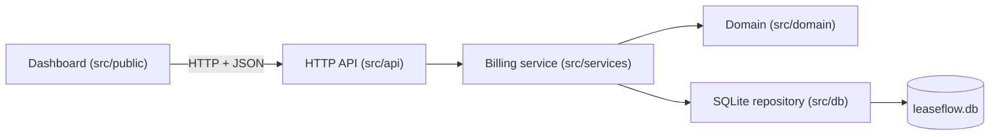
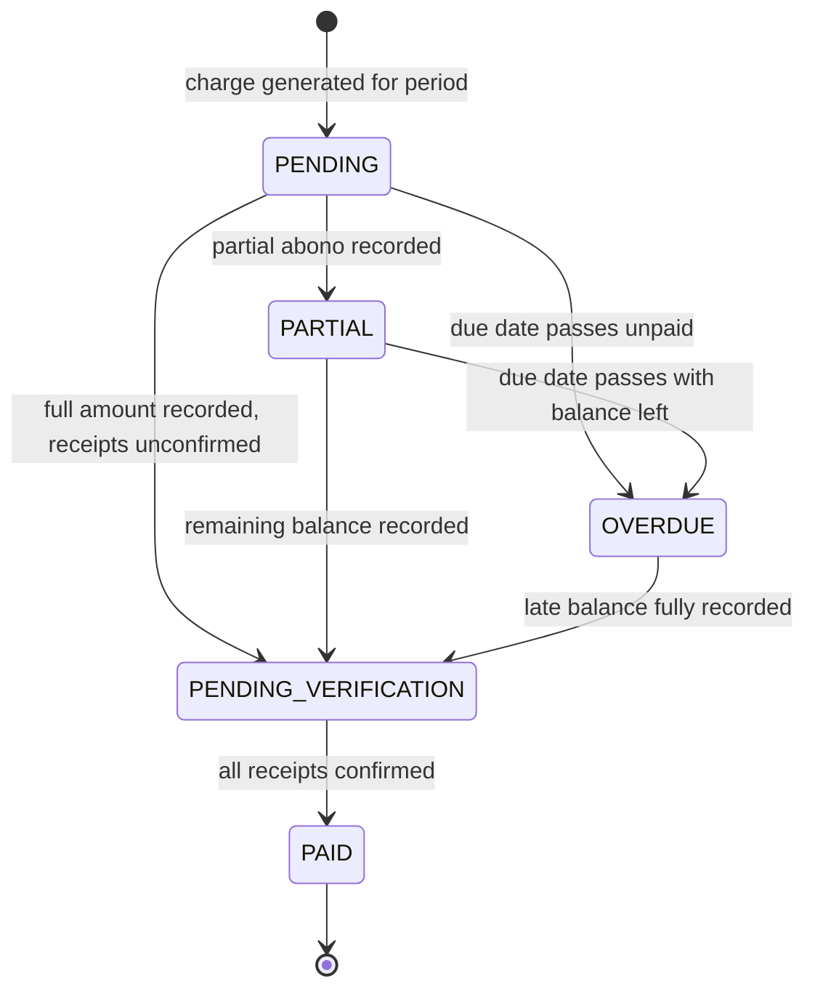

# LeaseFlow — rental lease billing & payment reconciliation engine

LeaseFlow is the ledger I wish I had when rent collection lived in a WhatsApp thread and a spreadsheet. It bills every active lease once per period, records partial payments (*abonos*) against a specific charge, holds transfer receipts until a human confirms them, and keeps overdue balances in plain sight — with money arithmetic that never drifts and due dates that survive short months. It is built for the way independent landlords across Latin America actually operate, and it runs as a single Node process: Express 4 over the built-in `node:sqlite`, one embedded database file, and a vanilla TypeScript dashboard. No native builds, no external services.

## Quick start

Requirements: **Node.js >= 22** (the engine talks to SQLite through the core `node:sqlite` module — nothing to compile) and npm.

```bash
npm install
npm run dev
```

Open <http://localhost:3000>. On first run the server creates `leaseflow.db` in the working directory, applies the schema (WAL journal mode, foreign keys enforced), and seeds a demo ledger: four leases with whole-peso COP rents, charges across two billing periods, and a payment history that surfaces every status the engine can report — including a lease billed on day 31 so end-of-month clamping is visible. Delete `leaseflow.db` (and its `-wal`/`-shm` siblings) to start from a clean slate; seeding is idempotent and never duplicates an existing ledger.

## What it solves

I built LeaseFlow around the three failure modes that break spreadsheet-based rent collection:

- **Uncontrolled partial payments.** Tenants pay in two or three transfers a month and the real balance gets lost. Here every payment is attached to one charge, and confirmed vs. awaiting-confirmation money and the exact remaining balance are recomputed on every read. A payment that would overpay the charge is rejected outright, with the remaining balance in the error message.
- **Unverified bank receipts.** A transfer screenshot is not money in the bank. Payments land as `PENDING_CONFIRMATION` and only count as collected once you approve the receipt. A charge fully covered by unconfirmed receipts is `PENDING_VERIFICATION` — and locked against new payments (409) — until every receipt is confirmed.
- **Due dates in short months.** Leases agreed on day 30 or 31 don't skip February. `calculateDueDate` clamps the payment day to the last valid day of the month (Feb 28, leap Feb 29, Apr/Sep 30), so no charge is orphaned or pushed into the next period.

## Architecture

Four layers, one file per responsibility. The domain knows nothing about HTTP or SQLite; the service layer orchestrates and maps to serializable views; the API validates input shape; the dashboard talks HTTP only.



- **`src/domain/`** — pure business rules, zero I/O: `money.ts` (immutable `Money` value object), `contract.ts` (lease entity + due-date algorithm), `charge.ts` (charge aggregate, totals, state machine), `errors.ts` (typed errors that carry HTTP semantics).
- **`src/db/`** — persistence: `database.ts` (schema + pragmas), `repository.ts` (typed row ↔ domain mapping; payments bucketed per charge to avoid N+1 reads), `seed.ts` (transactional, idempotent demo data).
- **`src/services/billing-service.ts`** — use cases: register lease, generate a period, list charges with filters, record payment, confirm receipt, portfolio summary.
- **`src/api/`** — `routes.ts` (the 8 endpoints + input validation), `error-handler.ts` (one error envelope for every failure).
- **`src/public/` + `src/server.ts`** — dashboard shell and the entry point that serves the UI and shuts down gracefully.

## The charge lifecycle

Every charge starts `PENDING` when generated. Status is *evaluated*, never stored — `evaluateStatus(charge, today)` derives it from payment history and the clock, with a deliberate precedence:

| Status | Meaning |
| --- | --- |
| `PENDING` | No money recorded yet, due date not passed |
| `PARTIAL` | Some money recorded (less than expected), not past due |
| `PENDING_VERIFICATION` | Recorded receipts cover the full amount, at least one unconfirmed |
| `PAID` | Confirmed money ≥ expected — stays `PAID` even after the due date |
| `OVERDUE` | Past due and not fully covered, with or without partial history |



Payments move through their own two-step flow: every payment starts `PENDING_CONFIRMATION` and becomes `CONFIRMED` only when you approve the bank receipt. Two guards keep the ledger honest:

- **Lock:** while a charge is `PENDING_VERIFICATION` or `PAID`, `addPayment` refuses new money with `ConflictError` → **409**.
- **Overpayment protection:** any payment that would push recorded money above the expected amount is rejected with `DomainValidationError` → **400**, quoting the exact remaining balance.

## Money & dates done right

- **Integer minor units.** Amounts are stored and summed as integer cents (`rent_minor`, `amount_minor`); floating point exists only at the API boundary, where `Money.fromDecimal` rounds half-up exactly once. `1850000` COP is `185000000` minor units, and dashboard totals are summed in minor units and converted once — no per-row drift.
- **Currency guard.** Only `COP` and `USD` are valid, and `Money.plus` refuses to combine different currencies; a payment in the wrong currency never touches the charge.
- **Day-31 clamping.** `calculateDueDate(year, month, paymentDayOfMonth)` resolves to `min(day, daysInMonth)`:

| Contract day | Period | Due date |
| --- | --- | --- |
| 31 | 2026-01 | 2026-01-31 |
| 31 | 2026-02 | 2026-02-28 |
| 31 | 2028-02 | 2028-02-29 (leap year) |
| 31 | 2026-04 | 2026-04-30 |
| 5 | any | the 5th, unchanged |

## API reference

| Method | Route | Purpose |
| --- | --- | --- |
| `GET` | `/api/health` | Liveness + server time |
| `GET` | `/api/summary` | Portfolio KPIs: expected, collected, pending-verification and overdue totals + collection rate |
| `GET` | `/api/contracts` | Leases with charge and overdue counts |
| `POST` | `/api/contracts` | Register a lease: `propertyName`, `tenantName`, `monthlyRent`, `paymentDayOfMonth` (1–31), `startDate`, optional `currency` (defaults to COP) → 201 |
| `GET` | `/api/charges` | Charges with full payment history; filters `?status=` and `?period=YYYY-MM` |
| `POST` | `/api/charges/generate` | Idempotently bill a period (`{ "period": "YYYY-MM" }`) for every `ACTIVE` lease → 201 when anything was created, 200 otherwise, `{ created, skipped, period }` |
| `POST` | `/api/charges/:id/payments` | Record a partial or full payment: `{ amount, reference }` → 201 with the payment and refreshed charge |
| `POST` | `/api/charges/:id/payments/:paymentId/confirm` | Approve a bank receipt; the charge re-evaluates → 200 |

Every failure uses one envelope:

```json
{ "error": { "code": "VALIDATION", "message": "Payment exceeds remaining balance of 850000.50" } }
```

`DomainValidationError` → **400 `VALIDATION`** · `NotFoundError` → **404 `NOT_FOUND`** · `ConflictError` → **409 `CONFLICT`** · unknown `/api/*` route → **404** · anything unexpected → **500 `INTERNAL`**, logged server-side and masked to the client.

A three-step reconciliation against the seeded ledger:

```bash
# bill November for every active lease -> 201 { "created": 4, "skipped": 0, "period": "2026-11" }
curl -X POST localhost:3000/api/charges/generate -H "Content-Type: application/json" -d '{"period":"2026-11"}'
# record the exact remaining balance on Maria Fernanda's October charge -> charge becomes PENDING_VERIFICATION
curl -X POST localhost:3000/api/charges/chg_202610_linda/payments -H "Content-Type: application/json" -d '{"amount":850000,"reference":"TRF-88431"}'
# approve Carlos Andres' pending full-amount receipt -> his charge becomes PAID
curl -X POST localhost:3000/api/charges/chg_202610_casa/payments/pay_202610_casa/confirm
```

## Dashboard

The UI at `/` is the whole operating console: portfolio snapshot KPIs (expected, collected, pending verification, overdue, collection rate), the charges table with status and period filters, expandable rows showing each charge's payment history plus a form to record a new payment, one-click **Confirm receipt** for pending transfers, a header form to generate a billing period, and a leases table with rent, payment day and overdue exposure. Amounts render in the ledger's currency, feedback arrives as toasts, and a health indicator in the footer tracks the API.

## Project structure

```text
leaseflow/
├── src/
│   ├── domain/
│   │   ├── errors.ts            # DomainValidationError / NotFoundError / ConflictError
│   │   ├── money.ts             # Immutable Money value object (integer minor units)
│   │   ├── contract.ts          # Contract entity + calculateDueDate clamping
│   │   └── charge.ts            # Charge aggregate, totals, state machine, payment rules
│   ├── db/
│   │   ├── database.ts          # node:sqlite open + schema + WAL/FK pragmas
│   │   ├── repository.ts        # Typed persistence; rows never leak into the domain
│   │   └── seed.ts              # Idempotent demo ledger (4 leases, whole COP)
│   ├── services/
│   │   └── billing-service.ts   # Use cases + serializable view models
│   ├── api/
│   │   ├── routes.ts            # 8 REST endpoints + input shape validation
│   │   └── error-handler.ts     # Single error envelope; domain errors → HTTP codes
│   ├── public/
│   │   ├── index.html           # Dashboard shell
│   │   ├── styles.css           # Executive light/dark theme
│   │   └── app.ts               # Vanilla TS console, served transpiled as /app.js
│   └── server.ts                # Express wiring, /app.js compile, graceful shutdown
├── tests/
│   ├── domain.test.ts           # Vitest unit suite for the domain rules
│   └── api.test.ts              # REST integration suite (supertest + in-memory SQLite)
├── package.json
├── tsconfig.json
└── README.md
```

## Configuration

| Variable | Default | Purpose |
| --- | --- | --- |
| `PORT` | `3000` | HTTP port for API + dashboard |
| `DB_PATH` | `leaseflow.db` | SQLite file path (`:memory:` runs an ephemeral ledger) |

| Script | Command | What it does |
| --- | --- | --- |
| `npm run dev` | `tsx watch src/server.ts` | Run with hot reload |
| `npm start` | `tsx src/server.ts` | Run once, no watch |
| `npm run build` | `tsc` | Type-check and emit to `dist/` |
| `npm run typecheck` | `tsc --noEmit` | Types only, no output |
| `npm test` | `vitest run` | Domain + API integration suites |
| `npm run test:coverage` | `vitest run --coverage` | Suite with V8 coverage |

`SIGINT`/`SIGTERM` trigger a graceful shutdown (close server → close database). With `NODE_ENV=production` the transpiled dashboard script is compiled once and cached.

## Testing

`npm test` runs two Vitest suites — 52 tests in total: the domain invariants as fast, I/O-free unit tests, and a REST integration suite that drives the real Express app through supertest against a seeded in-memory SQLite ledger.

The domain suite (`tests/domain.test.ts`) covers the engine's rules:

- **Money:** negative, non-integer and non-finite amounts and unsupported currencies rejected; half-up rounding (`1234.567` → `123457` minor); mixed-currency arithmetic refused.
- **Due dates:** day 31 clamps to `2026-02-28`, `2028-02-29` (leap year) and `2026-04-30`; invalid month/day inputs rejected.
- **Lifecycle:** all five statuses verified through payment + confirmation sequences; overpayment rejected citing the exact remaining balance (`850000.50`); zero amounts, blank references and currency mismatches rejected; new payments blocked while `PENDING_VERIFICATION` (`ConflictError`); double confirmation and unknown payment ids raise conflict/not-found.

The API suite (`tests/api.test.ts`) exercises every endpoint and its failure paths over real HTTP:

- **Lifecycle over HTTP:** generate a future period, record a half payment → `PARTIAL`, record the rest → `PENDING_VERIFICATION` (any further payment → 409), confirm both receipts → `PAID`; re-confirmation → 409, unknown charge/payment ids → 404.
- **Validation at the edge:** malformed JSON bodies, invalid periods/statuses/currencies and overpayments all come back through the single `{ error: { code, message } }` envelope with the documented status codes.
- **Time-independent by design:** date-sensitive scenarios are built on charges generated ~40 days ahead, whose due dates always lie in the future — the suites pass no matter which day they run.

## Design decisions

- **`node:sqlite` over better-sqlite3.** SQLite ships in the Node 22+ standard library, so a fresh clone runs with `npm install && npm run dev` and zero C++ compilation on any machine — the review experience matters more than the last millisecond.
- **The service layer never re-implements domain rules.** Routes validate *shape*; the domain validates *meaning*; `BillingService` only orchestrates the aggregate, persists it, and maps to view models. There is exactly one place where a billing rule lives.
- **UTC everywhere.** "Today" and timestamps come from `toISOString()`, and dates compare as `YYYY-MM-DD` strings, so every server timezone reaches the same overdue verdict for the same instant.
- **Charge status is derived, never stored.** `evaluateStatus` runs at read time, which makes stale states structurally impossible and lets the rules evolve without data migrations. The only persisted lifecycle is a receipt's `PENDING_CONFIRMATION` → `CONFIRMED`.

## License

MIT — see the `license` field in `package.json`.
